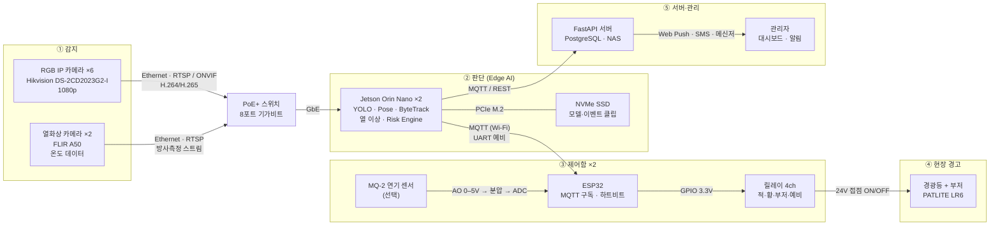
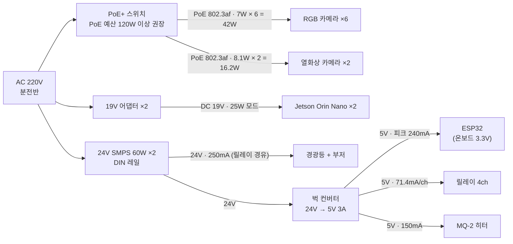

# 피지컬 AI 하드웨어 부품 사양 보고서

- 작성자: 박민성
- 작성일: 2026-10-14
- 대상 제품: AI 기반 작업장 안전관리 시스템 (PRD v1.0)

---

## 1. 개요

본 제품은 **RGB 카메라 + 열화상 카메라로 감지 → Edge AI(Jetson)에서 판단 → MCU가 경광등·부저를 구동**하는 구조다. 이 보고서는 PRD 4장 기술 스택과 6장 ROI 가정(1개 작업구역: RGB 6대, 열화상 2대, Edge 2대)에 들어가는 하드웨어 부품의 **전압, 전류(소비전력), 통신 방식**을 정리한다.

PRD에는 "1080p IP 카메라", "FLIR 계열", "ESP32 또는 STM32"처럼 부품 등급만 적혀 있다. 그래서 각 등급에서 **기준 모델 하나를 골라 데이터시트 값을 적었다.** 동급 다른 제품으로 바꿔도 되지만, 그때는 전원·통신 항목을 다시 확인해야 한다.

### 시스템 구성도

```
[RGB IP 카메라 ×6] ──┐ PoE(48V) + Ethernet / RTSP
[열화상 카메라 ×2] ──┤
                     ▼
              [PoE 스위치] ── Ethernet ── [사내망 / 서버(FastAPI, PostgreSQL, NAS)]
                     │                              ▲ MQTT / REST (이벤트·알림)
                     ▼ Ethernet                     │
         [Edge AI: Jetson Orin Nano ×2] ────────────┘
                     │ MQTT (Wi-Fi)  ※ 대안: UART / GPIO 직결
                     ▼
              [MCU: ESP32] ── ADC ── [보조 연기 센서(선택)]
                     │ GPIO 3.3V
                     ▼
              [릴레이 모듈] ── 24V DC 스위칭 ── [경광등 + 부저 일체형 신호탑]
```

### 부품 관계도 — 신호·데이터 흐름

감지부터 현장 경고까지는 현장 안에서 끝난다. 서버나 인터넷이 멈춰도 경보는 울린다.



### 부품 관계도 — 전원 계통

카메라는 랜선 하나로 전원(PoE)을 받고, 제어함은 24V 하나로 받아 5V로 낮춰 쓴다.



## 2. 부품별 사양 요약

| # | 구분 | 기준 모델(예시) | 수량 | 입력 전압 | 전류 / 소비전력 | 통신·인터페이스 |
|---|---|---|---:|---|---|---|
| 1 | Edge AI 컴퓨터 | NVIDIA Jetson Orin Nano Super Developer Kit (8GB) | 2 | DC 9–19V (19V 어댑터 동봉) | 전원 모드 7W / 15W / 25W / MAXN-Super, 25W 기준 19V에서 약 1.3A | GbE(RJ45), USB 3.2 Gen2 ×4, USB-C, MIPI CSI-2, M.2(NVMe), 40핀 헤더(GPIO·UART·I2C·SPI, 3.3V 로직) |
| 2 | RGB 카메라 | Hikvision DS-2CD2023G2-I (2MP 1080p 불릿) | 6 | PoE IEEE 802.3af 또는 DC 12V | PoE 시 최대 7W, DC 12V 시 최대 6W(정격 500mA) | Ethernet, RTSP, ONVIF, H.264/H.265 |
| 2-대안 | RGB 카메라(시연용) | USB 1080p 웹캠 (UVC) | - | USB 5V | 약 0.5A 이하 (USB 2.0 버스 전원) | USB UVC |
| 3 | 열화상 카메라 | Teledyne FLIR A50 (464×348) | 2 | DC 24/48V (허용 18–56V) 또는 PoE 802.3af Class 3 | 24V에서 7.5W(약 0.31A), PoE 시 8.1W, 최대 8W급 | Ethernet, RTSP(H.264/MJPEG, 방사측정 스트림), Modbus TCP(Smart Sensor 모델), HTTP, M12 커넥터(디지털 I/O 겸용) |
| 3-대안 | 열화상 모듈(시연용) | FLIR Lepton 3.5 + PureThermal 보드 | - | 모듈 단독은 저전압(데이터시트 참조), 보드 사용 시 USB 5V | 모듈 약 140mW (셧다운 5mW) | 모듈: SPI(영상, VoSPI) + I2C(제어) / 보드: USB UVC |
| 4 | MCU | ESP32-DevKitC (ESP32-WROOM-32E) | 2 | 모듈 3.0–3.6V, 보드는 USB 5V 또는 5V 핀 입력 | Wi-Fi 송신 시 약 239mA, 수신 약 112mA, 전원은 500mA 이상 권장 | Wi-Fi 802.11 b/g/n, Bluetooth, UART, I2C, SPI, ADC, GPIO(3.3V) |
| 4-대안 | MCU | STM32 Nucleo (예: F446RE) | - | USB 5V 또는 외부 7–12V | 수십 mA 수준 | UART, I2C, SPI, CAN, GPIO (무선 없음 → Jetson과 UART/USB 유선 연결) |
| 5 | 릴레이 모듈 | 4채널 5V 릴레이 모듈 (Songle SRD-05VDC-SL-C) | 2 | 코일 DC 5V | 코일 1개당 71.4mA (360mW), 4채널 동시 ON 시 약 0.29A | GPIO 디지털 입력(포토커플러 모듈 권장), 접점 10A 250VAC / 10A 30VDC |
| 6 | 경광등 + 부저 | PATLITE LR6 시리즈 부저 내장형 (24V DC) | 2 | DC 24V | 부저 모델 약 250mA (약 6W) | 무전압 접점/전원 인가 방식 (릴레이로 ON/OFF) |
| 7 | 보조 연기·가스 센서(선택) | MQ-2 센서 모듈 | 2 | DC 5V (히터) | 히터 약 150mA (약 800mW) | 아날로그 출력 0–5V(AO), 디지털 출력(DO, 임계값) |
| 8 | PoE 스위치 | 8포트 PoE+ 기가비트 스위치 (예: TP-Link TL-SG1210P) | 1 | AC 100–240V | PoE 예산 63W, 포트당 최대 30W | IEEE 802.3af/at, 1Gbps |
| 9 | 24V 전원 공급기 | DIN 레일 SMPS 24V 2.5A급 (예: Mean Well HDR-60-24) | 2 | AC 100–240V → DC 24V | 출력 약 60W | - |
| 10 | 강압 컨버터 | DC-DC 24V → 5V 3A 벅 컨버터 | 2 | DC 24V 입력 | 5V 출력 최대 3A | - |
| 11 | 저장장치 | M.2 NVMe SSD (256GB 이상) | 2 | M.2 슬롯 3.3V | 수 W 이하 | PCIe (Jetson M.2 Key-M) |

> 수량은 PRD ROI 가정(1개 작업구역, Edge 2대)을 따랐다. MCU·릴레이·경광등·센서는 Edge 1대당 1세트로 잡았다.

## 3. 부품별 상세

### 3.1 Edge AI 컴퓨터 — NVIDIA Jetson Orin Nano Super Developer Kit

- **역할**: RGB·열화상 스트림을 받아 YOLO 검출, 자세 추정, 추적, 열 이상 분석, 위험도 판단까지 현장에서 수행한다. 네트워크가 끊겨도 경보가 동작해야 하므로 핵심 부품이다.
- **전원**: DC 9–19V, 19V 어댑터 동봉. 전원 모드는 7W / 15W / 25W / MAXN-Super다. 카메라 4대를 동시에 추론하면 25W 모드 이상을 기준으로 잡는다.
- **연산**: Ampere GPU 1024 CUDA 코어, Tensor 코어 32개, Cortex-A78AE 6코어, LPDDR5 8GB.
- **통신**
  - 카메라 입력: Gigabit Ethernet으로 RTSP 수신 (USB 웹캠은 USB 3.2, CSI 카메라는 MIPI CSI-2)
  - 서버 연동: Ethernet 기반 MQTT / REST
  - MCU 연동: MQTT(Wi-Fi) 또는 40핀 헤더의 UART·GPIO 직결
- **주의**: 40핀 헤더 GPIO는 **3.3V 로직**이다. 5V 릴레이 코일을 GPIO로 직접 구동하면 안 된다.

### 3.2 RGB 카메라 — Hikvision DS-2CD2023G2-I (1080p IP 불릿)

- **역할**: 작업자 낙상, 통로 위험물, 화염·연기를 영상으로 감지한다.
- **전원**: PoE(802.3af) 또는 DC 12V / 500mA. 최대 소비전력은 PoE 7W, DC 12V 6W다. 랜선 하나로 전원과 데이터를 함께 보내는 **PoE 사용을 권장**한다.
- **통신**: Ethernet, RTSP 스트리밍, ONVIF 표준, H.264/H.265 코덱. PRD의 영상 프로토콜(RTSP/ONVIF)과 맞는다.
- **대안**: 시연 단계에서는 USB 1080p 웹캠(USB 5V 버스 전원, UVC)을 Jetson USB에 직접 연결해도 된다.

### 3.3 열화상 카메라 — Teledyne FLIR A50

- **역할**: 설비 과열과 이상 고온을 온도값으로 감지한다. 절대온도 임계값과 온도 상승률(°C/s) 규칙에 쓰인다.
- **전원**: DC 24/48V(허용 18–56V) 또는 PoE 802.3af Class 3. 소비전력은 24V에서 7.5W, PoE에서 8.1W 정도다.
- **통신**: Ethernet, RTSP(H.264/MPEG4/MJPEG 영상, 방사측정 스트림), HTTP 등. Smart Sensor 구성 모델은 Modbus TCP를 지원해 PLC와 직접 연동할 수 있다. 커넥터는 M12 12핀(전원·디지털 I/O 겸용)이다.
- **대안(시연용)**: FLIR Lepton 3.5 모듈(160×120, 약 140mW)을 PureThermal 보드에 꽂으면 USB UVC 웹캠처럼 인식된다. 모듈 단독으로 쓰면 SPI(영상)와 I2C(제어)로 직접 통신해야 한다. 프레임은 약 9Hz로 산업용보다 느리므로 PoC 용도로만 쓴다.

### 3.4 MCU — ESP32-DevKitC (ESP32-WROOM-32E)

- **역할**: Jetson의 위험 이벤트를 받아 릴레이(경광등·부저)를 켜고 끈다. 보조 센서 값을 읽는다.
- **전원**: 모듈 3.0–3.6V. DevKit 보드는 USB 5V나 5V 핀으로 받아 온보드 레귤레이터가 3.3V로 낮춘다. Wi-Fi 송신 시 순간 전류가 약 240mA라서 **전원은 500mA 이상**을 확보해야 한다.
- **통신**: Wi-Fi(802.11 b/g/n)로 MQTT 구독, Bluetooth, UART, I2C, SPI, ADC, GPIO.
- **설계 포인트**: Wi-Fi가 불안정한 현장이면 Jetson과 **UART(USB-시리얼) 유선 연결**을 병행한다. 그래야 PRD의 "인터넷 연결 없이도 즉각적인 물리적 대응" 요구를 만족한다.
- **대안**: STM32는 무선이 없으므로 Jetson과 UART/USB로 연결한다. 산업 현장에서 장기 안정성과 실시간성이 더 중요할 때 고른다.

### 3.5 릴레이 모듈 — 5V 4채널 (SRD-05VDC-SL-C)

- **역할**: MCU의 3.3V 신호로 24V 경광등·부저 전원을 켜고 끈다.
- **전원**: 코일 DC 5V, 코일 1개당 71.4mA(70Ω, 360mW). 4채널을 모두 켜면 약 0.29A다.
- **접점 정격**: 10A 250VAC / 10A 30VDC. 24V·250mA 신호탑 부하에는 여유가 크다.
- **인터페이스**: GPIO 디지털 입력. **포토커플러 절연형 모듈(JD-VCC 분리형)**을 쓰면 ESP32 3.3V 출력으로도 안정적으로 구동되고 노이즈가 MCU로 들어오지 않는다.
- **채널 배분 예시**: CH1 적색등, CH2 황색등, CH3 부저, CH4 예비(설비 비상정지 연동 등).

### 3.6 경광등 + 부저 — PATLITE LR6 부저 내장형 (24V DC)

- **역할**: 위험 Level에 따라 현장 작업자에게 시각·청각으로 경고한다.
- **전원**: DC 24V. 부저 내장 모델 소비전류는 약 250mA다.
- **제어 방식**: 색상·부저 선마다 24V를 인가하는 방식이라 별도 통신이 없다. 릴레이 접점으로 ON/OFF 한다.
- **환경**: IP65, 사용 온도 -20~50°C로 공장·창고 환경에 맞다.
- **참고**: 국산 동급품(Q-Light 등)도 24V DC 신호탑이 일반적이다. 색상 수와 부저 음량(dB)을 현장 소음에 맞춰 고른다.

### 3.7 보조 연기·가스 센서 — MQ-2 (선택)

- **역할**: PRD의 "온도·연기 센서(선택)". 카메라 AI의 화재 판단을 보조해 오탐을 줄인다.
- **전원**: 히터 DC 5V, 약 150mA(약 800mW). 예열 시간이 필요하다.
- **통신**: 아날로그 출력(AO, 0–5V)과 디지털 출력(DO, 임계값 비교).
- **주의**
  - ESP32 ADC 입력은 최대 약 3.3V다. **AO를 분압 저항으로 낮춰서** 연결해야 한다.
  - MQ-2는 PoC용 저가 센서다. 인증 소방 감지기를 대신할 수 없다. 실제 현장에서는 기존 화재감지기의 접점 출력을 MCU에 입력받는 편이 낫다.

### 3.8 네트워크·전원 부품

- **PoE 스위치**: 8포트 PoE+ 스위치(예: TP-Link TL-SG1210P)는 802.3af/at을 지원하고 포트당 최대 30W, **전체 예산은 63W**다. 4장 전력 계산 결과처럼 카메라 8대를 한 스위치에 물리면 예산이 빠듯하다. **PoE 예산 120W 이상 모델을 권장**하거나 스위치 2대로 나눈다.
- **24V SMPS**: 경광등·부저용 DC 24V를 만든다. 산업 현장은 DIN 레일 타입(예: Mean Well HDR-60-24, 24V 2.5A)이 설치·교체가 편하다.
- **DC-DC 벅 컨버터**: 24V를 5V로 낮춰 ESP32, 릴레이 코일, MQ-2 히터에 공급한다. 한 제어함 안에 전원을 24V 하나로 통일하려는 목적이다.
- **NVMe SSD**: Jetson의 M.2 Key-M 슬롯에 장착한다. OS, TensorRT 엔진, 위험 이벤트 클립 임시 저장용이다.

## 4. 전력 예산 (1개 작업구역 기준)

| 구분 | 계산 | 소비전력 |
|---|---|---:|
| RGB 카메라 | 7W × 6대 | 42.0W |
| 열화상 카메라 | 8.1W × 2대 | 16.2W |
| **PoE 부하 소계** | | **58.2W** |
| Jetson Orin Nano | 25W × 2대 | 50.0W |
| 신호탑(경광등+부저) | 24V × 0.25A × 2대 | 12.0W |
| 릴레이 모듈 | 5V × 0.29A × 2대 (전 채널 ON) | 2.9W |
| ESP32 | 3.3V × 0.24A × 2대 (송신 피크) | 1.6W |
| MQ-2 센서(선택) | 5V × 0.15A × 2대 | 1.5W |
| **합계(최대치)** | | **약 126W** |

- PoE 부하 58.2W는 63W 예산 스위치의 92%다. 기동 돌입 전력과 IR 조명(야간) 피크를 고려하면 **120W 이상 PoE 예산**을 확보하는 것이 안전하다.
- 제어함 하나(Edge 1대분)의 24V 부하는 신호탑 6W + 5V 계통(릴레이·ESP32·MQ-2 약 3W를 벅 효율 85%로 환산 약 3.5W)으로 약 10W다. 24V 60W SMPS로 충분하다.
- 합계 약 126W를 24시간 상시 운전해도 하루 약 3kWh 수준이다. PRD OPEX의 "Edge 장치 및 카메라 전력비 월 10만 원" 가정 안에 들어간다.

## 5. 통신 구조 요약

| 구간 | 방식 | 물리 계층 | 비고 |
|---|---|---|---|
| RGB 카메라 → Jetson | RTSP(H.264/H.265), ONVIF | Ethernet(PoE) | 1080p, 카메라별 스트림 |
| 열화상 카메라 → Jetson | RTSP(영상 + 방사측정 데이터), HTTP | Ethernet(PoE) | 온도값 직접 사용 |
| Jetson → 서버 | MQTT(이벤트), REST(조회·설정) | Ethernet | FastAPI 백엔드, PostgreSQL 저장 |
| Jetson → MCU | MQTT (주) / UART (예비) | Wi-Fi / USB-시리얼 | 경보 명령: 위험 Level, 장치 ID |
| MCU → 릴레이 | 디지털 출력 | GPIO 3.3V | 포토커플러 절연 모듈 |
| 릴레이 → 신호탑 | 24V 전원 인가 | 접점 배선 | 색상·부저 채널별 |
| 보조 센서 → MCU | 아날로그 / 디지털 | ADC / GPIO | AO는 분압 후 입력 |
| 서버 → 관리자 | Web Push / SMS / 메신저 API | 인터넷 | 위험 수준별 알림 |

**경보 경로를 서버와 분리한 이유**: 위험 판단(Jetson)에서 경보 출력(MCU → 릴레이 → 신호탑)까지 모두 현장 안에서 끝난다. 그래서 외부 인터넷이나 서버가 멈춰도 "감지 후 3초 이내 현장 경고"라는 PRD 성공 지표를 지킬 수 있다.

## 6. 설계 시 주의사항

1. **전압 레벨**: Jetson·ESP32 GPIO는 3.3V다. 5V 센서 출력(MQ-2 AO 등)은 분압하고, 5V 릴레이는 절연형 모듈로 구동한다.
2. **접지·노이즈**: 24V 부하(신호탑)와 MCU 로직 계통은 포토커플러로 분리한다. 공장 설비 노이즈가 MCU 리셋을 일으키는 일을 막기 위해서다.
3. **PoE 예산**: 카메라 소비전력의 합만 보지 말고 스위치 전체 예산과 포트당 등급(802.3af 15.4W / 802.3at 30W)을 함께 확인한다.
4. **페일세이프**: MCU에 하트비트를 두어 Jetson 신호가 일정 시간 끊기면 황색등을 켜는 등 "시스템 이상"을 현장에 알린다.
5. **환경 등급**: 카메라·신호탑은 IP65 이상, 제어함은 분진·습기 대응 함체를 쓴다. 현장조사 체크리스트(`AI_작업장안전_현장조사_체크리스트.md`)의 환경 항목과 맞춰 최종 선정한다.
6. **인증**: 보조 연기 센서는 법정 화재감지기를 대체하지 않는다. 기존 소방설비와 병행한다.

## 7. 참고 자료

- [NVIDIA Jetson Orin Nano Super Developer Kit 사양 (Kiwi Electronics)](https://www.kiwi-electronics.com/en/single-board-computers-390/nvidia-jetson-orin-nano-super-developer-kit-11461)
- [Hikvision DS-2CD2023G2-I 사양 (ivel.pl)](https://en.ivel.pl/p26931,ip-camera-ds-2cd2023g2-i28mmd-acusense-1080p-hikvision.html)
- [Teledyne FLIR A50/A70 Image Streaming 제품 페이지](https://www.flir.com/de/products/a50_a70-image-streaming)
- [FLIR A50 사양 (tester.co.uk)](https://www.tester.co.uk/teledyne-flir-a50-advanced-smart-sensor-automation-thermal-camera-choice-of-lens)
- [FLIR Lepton 3.5 (Cirkit Designer)](https://docs.cirkitdesigner.com/component/f00fe564-9f25-4184-a8eb-b7432d971da5/flir-lepton-35)
- [ESP32-WROOM-32E 데이터시트 (Espressif)](https://www.espressif.com/sites/default/files/documentation/esp32-wroom-32e_esp32-wroom-32ue_datasheet_en.pdf)
- [Songle SRD-05VDC-SL-C 릴레이 (LCSC)](https://www.lcsc.com/product-detail/C35449.html)
- [PATLITE LR6 부저 내장 신호탑 (RS Online)](https://uk.rs-online.com/web/p/signal-towers/1701761)
- [MQ-2 센서 (Winsen)](https://winsen-sensor.com/sensors/combustible-sensor/mq2.html)
- [TP-Link TL-SG1210P 사양 (LDLC)](https://ldlc.com/en/product/PB00405092.html)

> 사양 값은 위 판매처·제조사 페이지 기준이다. 구매 전에는 정확한 모델 번호의 최신 제조사 데이터시트로 다시 확인한다. Mean Well SMPS와 벅 컨버터는 일반적인 규격으로 적은 것이라 모델 확정 후 확인이 필요하다.
